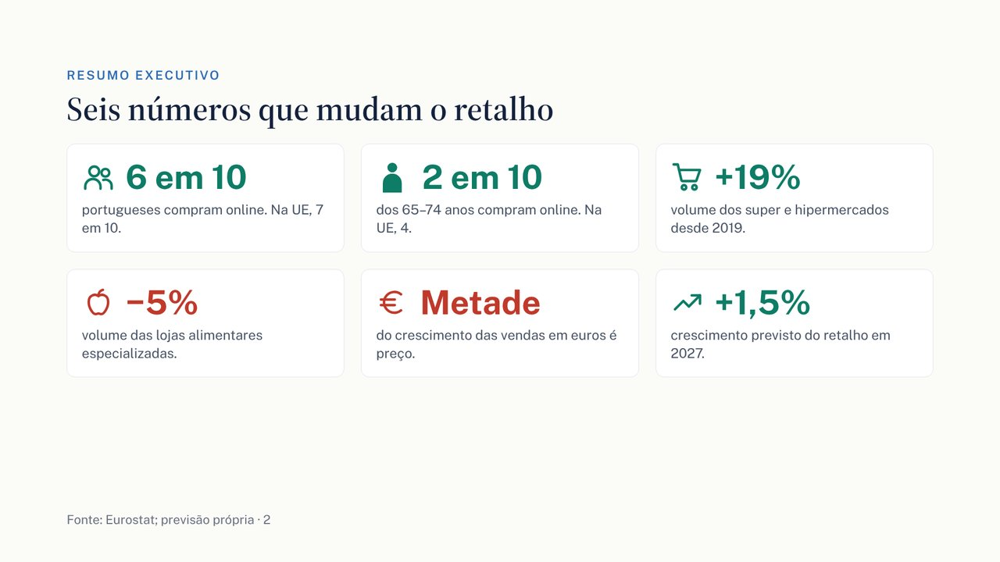
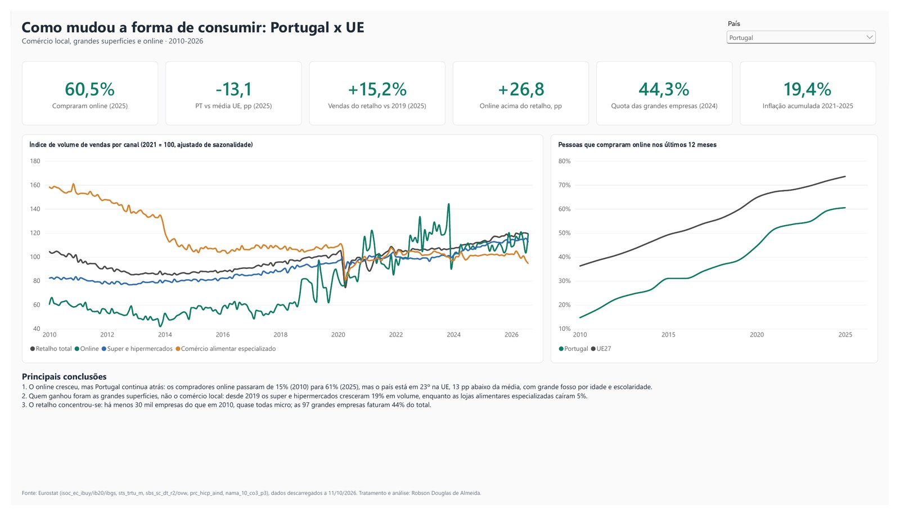
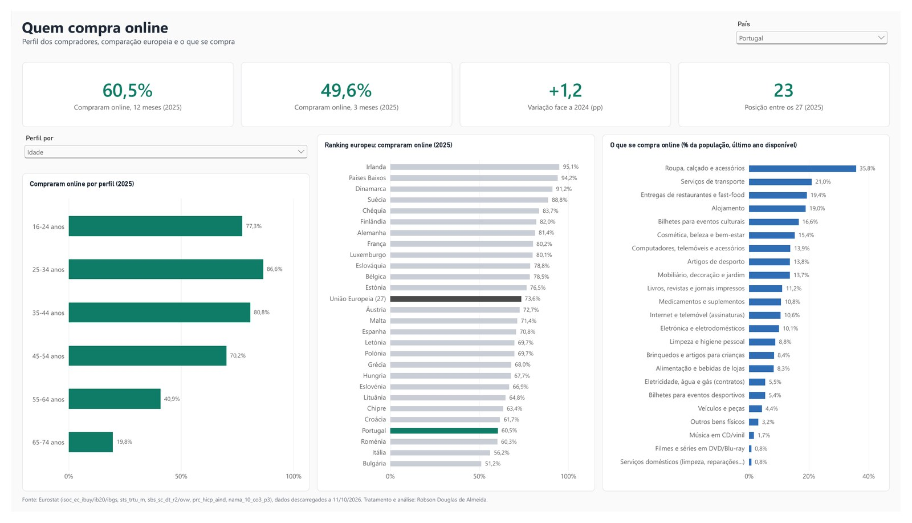
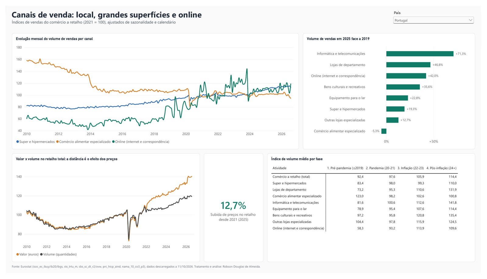
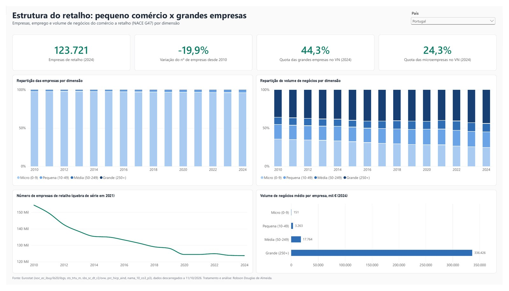
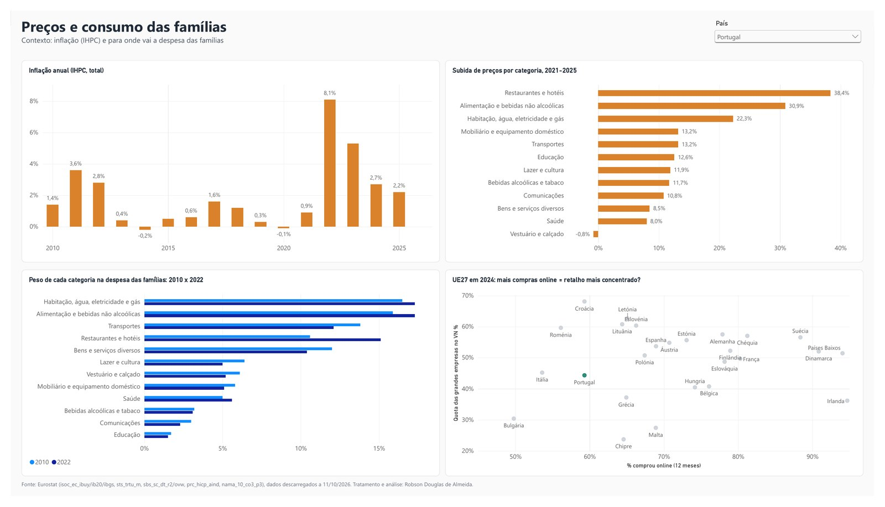
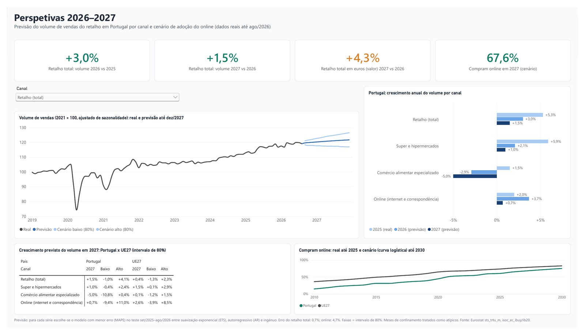
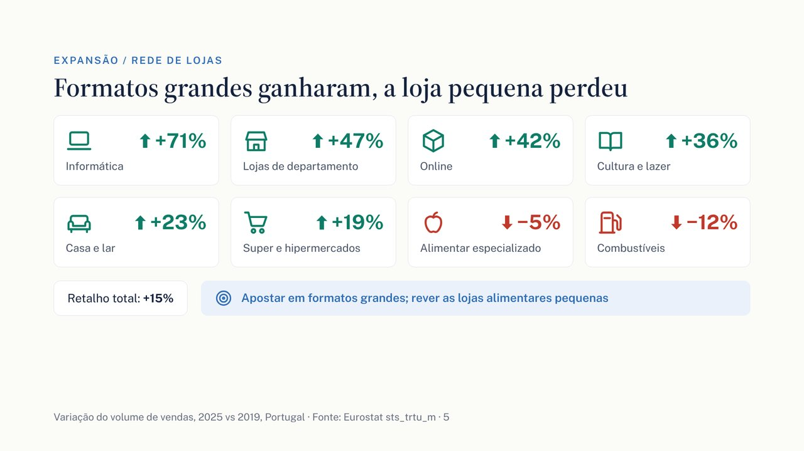
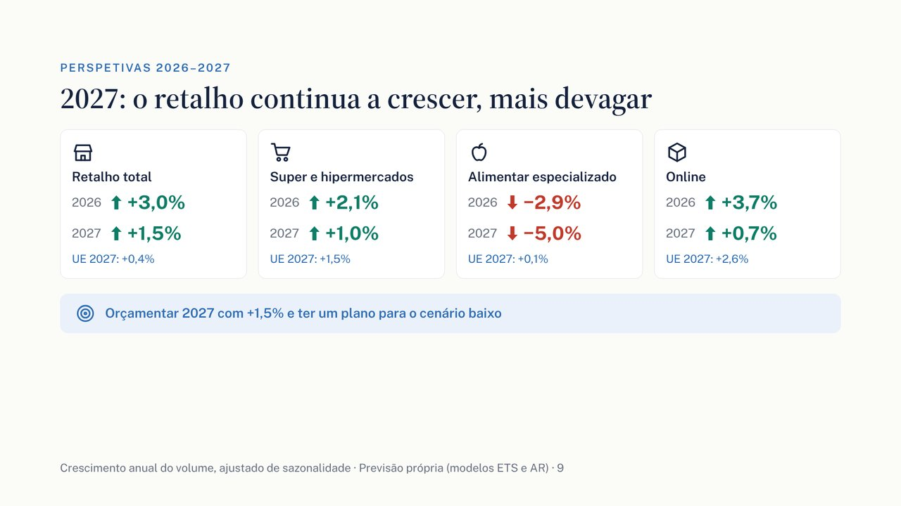

# Consumo em Portugal: o que muda para o retalho

Estudo de mercado sobre o setor de retalho em **Portugal × UE27**, de 2010 a 2026, com previsão até 2027. O estudo cobre o comércio local, as grandes redes e o online, e tira conclusões para cada departamento de uma empresa de retalho: Direção, Marketing, Expansão, E-commerce, Pricing e Finanças.

Projeto de portfólio em análise e tratamento de dados, de ponta a ponta:
1. Dados públicos do Eurostat.
2. ETL em Python.
3. Modelo em estrela no Power BI (formato PBIP/TMDL).
4. Previsão das vendas e da adoção do online.
5. Relatório e apresentação para a tomada de decisão.



## Principais conclusões

| Tema | O que os dados mostram | Recomendação |
|---|---|---|
| Online | 61% dos portugueses compram online, contra 74% na UE. Portugal é 23.º em 27. | Dar ao online metas próprias |
| Clientes | Dos 65 aos 74 anos, só 20% compram online (na UE, 44%) | Primeira compra assistida para os 55+ e as zonas rurais |
| Formatos | Desde 2019, os super e hipermercados cresceram +19% em volume; o comércio alimentar especializado caiu 5% | Apostar em formatos grandes e rever a rede de lojas pequenas |
| Preços | Vendas +31% em euros, mas só +15% em quantidade | Medir volume e valor em separado; reforçar a marca própria |
| Estrutura | 96% das empresas são micro; as 97 grandes faturam 44% (na UE, 51%) | Espaço para consolidar com parcerias e aquisições |
| Previsão | Retalho +3,0% em 2026 e +1,5% em 2027 (UE +0,4%) | Orçamentar 2027 com +1,5% e ter um plano para o cenário baixo |

## Entregáveis

- [Relatório (PDF)](entregaveis/Relatorio_Consumo_PT_UE.pdf) · [Word](entregaveis/Relatorio_Consumo_PT_UE.docx)
- [Apresentação (PDF)](entregaveis/Apresentacao_Consumo_PT_UE.pdf) · [PowerPoint](entregaveis/Apresentacao_Consumo_PT_UE.pptx), com notas do apresentador
- Dashboard Power BI: abrir `Tendencias_Consumo_PT_UE.pbip` no Power BI Desktop · [todas as páginas em PDF](entregaveis/Dashboard_Tendencias_Consumo_PT_UE.pdf)

## Dashboard

O dashboard tem 6 páginas. Nas páginas 1 a 5 há um filtro de país, sincronizado entre elas, para comparar qualquer Estado-membro com a UE27.

**1. Visão geral:** indicadores principais, evolução das vendas por canal e compras online.


**2. Quem compra online:** perfil dos compradores, ranking europeu e categorias compradas.


**3. Canais de venda:** comércio local, grandes superfícies e online.


**4. Estrutura do retalho:** pequeno comércio x grandes empresas.


**5. Preços e consumo das famílias**


**6. Perspetivas 2026–2027:** previsão por canal e cenário de adoção do online.


## Apresentação

<p>


</p>

## Estrutura do repositório

```
scripts/        etl_consumo.py (ETL) e previsao.py (modelos de previsão)
saida/          tabelas tratadas: fatos e dimensões (CSV ; decimal ,) e gráficos da previsão
modelo/         script TMDL do modelo, medidas DAX e guia de montagem no Power BI
Tendencias_Consumo_PT_UE.pbip            projeto Power BI
Tendencias_Consumo_PT_UE.Report/         páginas e visuais (PBIR)
Tendencias_Consumo_PT_UE.SemanticModel/  modelo semântico (TMDL)
entregaveis/    relatório e apresentação
docs/           imagens do dashboard e dos slides
dados brutos/   (não versionado) ficheiros TSV do Eurostat
```

## Dados

Fonte: [Eurostat](https://ec.europa.eu/eurostat/data/database). Os dados foram descarregados em 11/10/2026.

| Código | Conteúdo |
|---|---|
| isoc_ec_ibuy / isoc_ec_ib20 | Compras online por indivíduos (série até 2019 e série nova a partir de 2020) |
| isoc_ec_ibgs | O que se compra online, por categoria |
| sts_trtu_m | Vendas do comércio a retalho, mensal, por atividade NACE |
| sbs_sc_dt_r2 / sbs_sc_ovw | Empresas por dimensão (micro, pequena, média, grande) |
| prc_hicp_aind | Inflação (IHPC) por categoria COICOP |
| nama_10_co3_p3 | Despesa de consumo das famílias por finalidade |

Os ficheiros brutos (≈270 MB) não estão no repositório. Para os obter, descarregar cada código para a pasta `dados brutos/` a partir de:
`https://ec.europa.eu/eurostat/api/dissemination/sdmx/2.1/data/<código>?format=TSV&compressed=false`

## Como reproduzir

```bash
pip install pandas numpy scipy matplotlib
python scripts/etl_consumo.py "dados brutos" saida
python scripts/previsao.py "dados brutos" saida
```

Depois, abrir o `.pbip` no Power BI Desktop. Se o caminho da pasta mudar, atualizar o parâmetro `PastaSaida` (Transformar dados › Gerir parâmetros) com o caminho da pasta `saida`.

## Modelo de dados

O modelo é um esquema em estrela com 7 tabelas de fatos e 8 dimensões.

- **Tabelas de fatos:**
  - vendas do retalho (mensal)
  - compras online
  - categorias online
  - estrutura do retalho
  - inflação
  - consumo das famílias
  - previsão
- **Dimensões:** tempo, ano (com as fases pré-pandemia, pandemia, inflação e pós-inflação), país, atividade/canal, perfil do comprador, categoria online, COICOP e dimensão de empresa.
- **Validação:** os totais do ETL foram comparados com os ficheiros originais (`saida/validacao_totais.csv`), e as medidas DAX foram conferidas com os mesmos cálculos feitos em pandas.

## Previsão

- **Séries:** volume de vendas por canal (retalho total, super e hipermercados, comércio alimentar especializado e online), para Portugal e UE27.
- **Modelos comparados:**
  - Holt-Winters com tendência amortecida
  - modelo autorregressivo (12 desfasamentos, tendência e mês)
  - modelo ingénuo
- **Escolha do modelo:** em cada série fica o de menor erro (MAPE) num backtest com os últimos 12 meses. O erro médio é de 0,7% no retalho total e de 4,8% no online.
- **Pandemia e intervalos:** os meses de confinamento foram tratados como valores atípicos. Os intervalos de 80% e 95% vêm de 2000 simulações por bootstrap.
- **Adoção do online:** a curva logística ajustada a 2010–2025 dá 75% de compradores em 2030 (cenário).

## Limitações

- Os dados são índices de volume e valor, não vendas por empresa.
- As categorias de compras online só vão até 2024.
- Há quebras de série em 2020 (compras online) e 2021 (estrutura das empresas).
- A previsão não antecipa choques de preços ou de política.

---
Robson Douglas de Almeida · Análise e tratamento de dados · Python · Power BI
